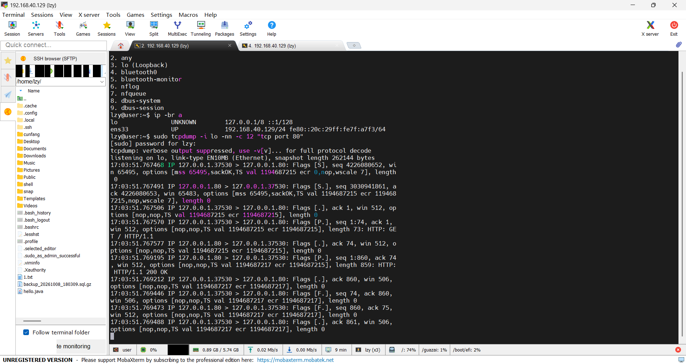
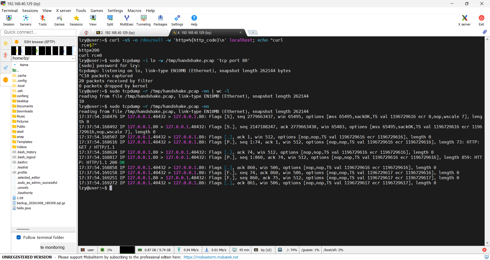
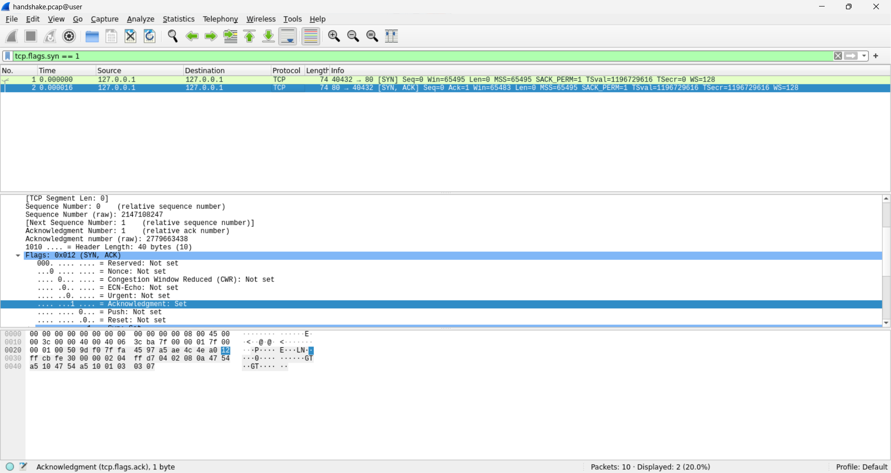
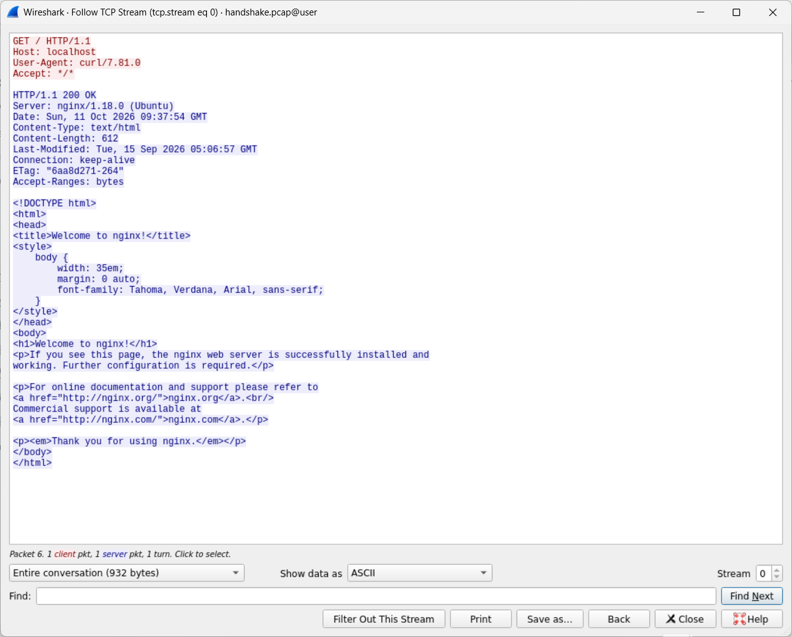
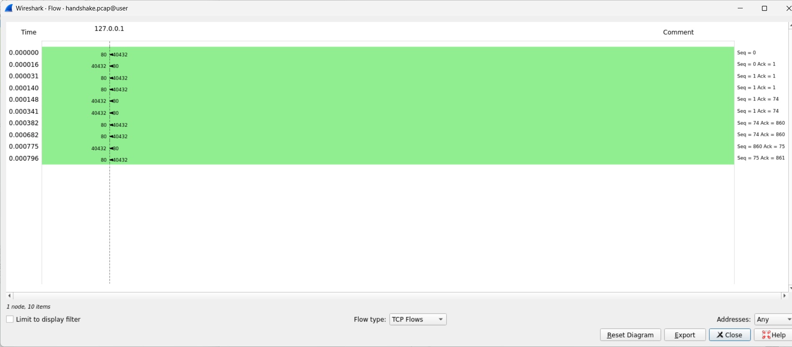
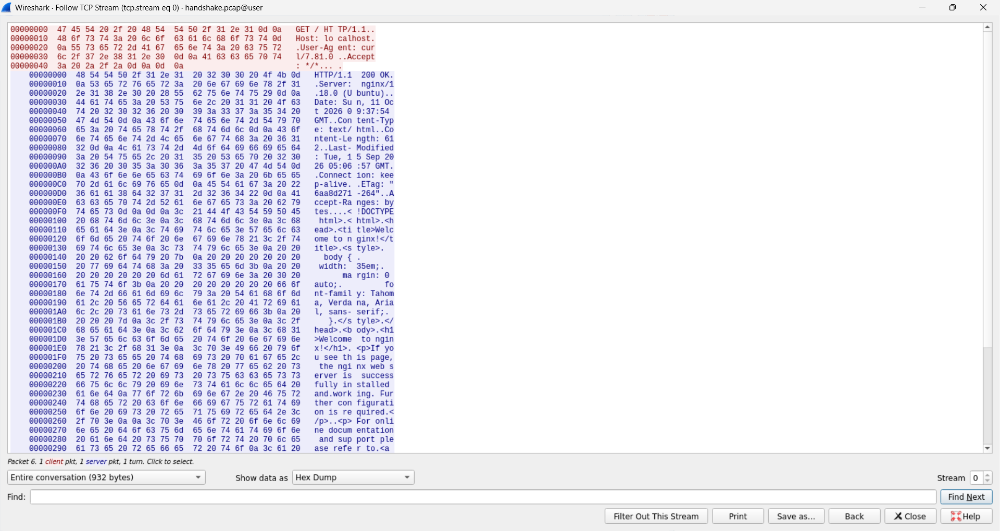
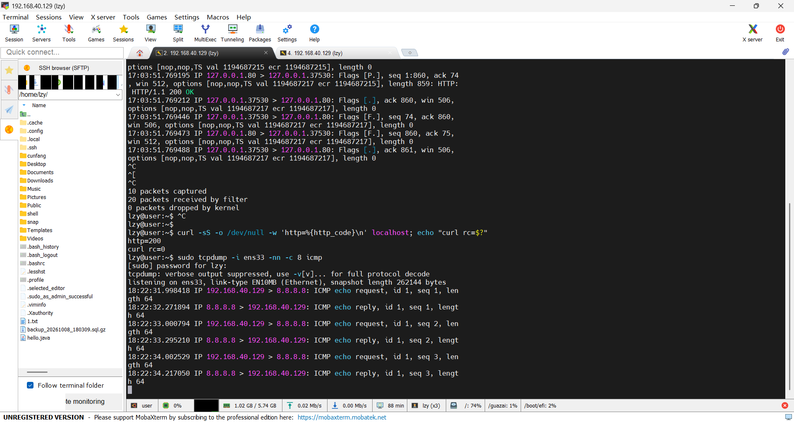
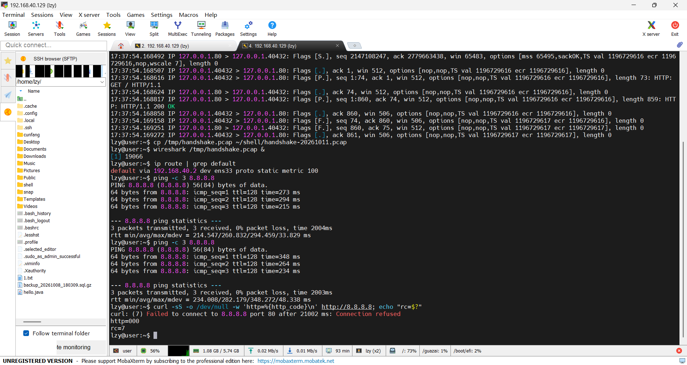
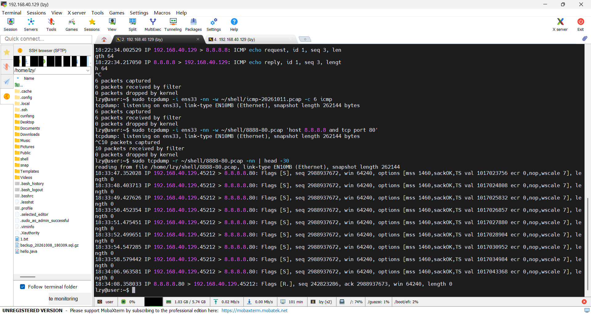
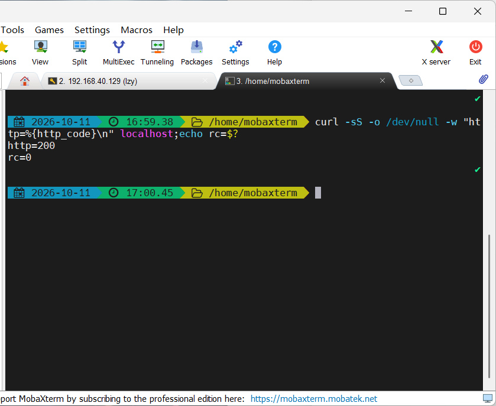

# 抓包实验:TCP 三次握手与 ICMP

环境:Ubuntu 22.04(VMware)· 网卡 `lo` / `ens33`(192.168.40.129/24)· 日期 2026-10-11
工具:tcpdump + Wireshark(MobaXterm 经 X 转发显示)
配套文档:troubleshooting.md、exit-codes.md

---

## 一、目标

用 tcpdump 抓一次完整的三次握手和一次 ICMP,在 Wireshark 里把同一个 pcap 读透,标出 SYN / SYN-ACK / ACK 与 Seq、Ack 号,并解释清 `Ack = 对方 Seq + 1` 的道理。

造流量用 `curl`,因为"命令 → 结果"能一一对应,比抓浏览器流量清楚。

---

## 二、原始证据

### 2.1 三次握手的抓包命令

```bash
sudo tcpdump -i lo -nn -c 12 "tcp port 80"
```

- `-i lo`:必须显式指定。不写就抓 `ens33`,而本机访问本机走的是回环,**一条都不会抓到**。
- `-nn`:不解析主机名和端口名,屏幕上直接显示 `80` 而不是 `http`。
- `-c 12`:上限 12 个包。**实测这条会话只有 10 个包,所以它没抓满,是按 Ctrl+C 停的。**



### 2.2 三次握手原文(10 个包,端口 37530)

```text
17:03:51.767468 IP 127.0.0.1.37530 > 127.0.0.1.80: Flags [S],  seq 4226080652, win 65495, options [mss 65495,sackOK,TS val 1194687215 ecr 0,nop,wscale 7], length 0
17:03:51.767491 IP 127.0.0.1.80 > 127.0.0.1.37530: Flags [S.], seq 3030941861, ack 4226080653, win 65483, options [mss 65495,sackOK,TS val 1194687215 ecr 1194687215,nop,wscale 7], length 0
17:03:51.767506 IP 127.0.0.1.37530 > 127.0.0.1.80: Flags [.],  ack 1, win 512, length 0
17:03:51.767570 IP 127.0.0.1.37530 > 127.0.0.1.80: Flags [P.], seq 1:74, ack 1, win 512, length 73: HTTP: GET / HTTP/1.1
17:03:51.767577 IP 127.0.0.1.80 > 127.0.0.1.37530: Flags [.],  ack 74, win 512, length 0
17:03:51.769195 IP 127.0.0.1.80 > 127.0.0.1.37530: Flags [P.], seq 1:860, ack 74, win 512, length 859: HTTP: HTTP/1.1 200 OK
17:03:51.769212 IP 127.0.0.1.37530 > 127.0.0.1.80: Flags [.],  ack 860, win 506, length 0
17:03:51.769446 IP 127.0.0.1.37530 > 127.0.0.1.80: Flags [F.], seq 74, ack 860, win 506, length 0
17:03:51.769473 IP 127.0.0.1.80 > 127.0.0.1.37530: Flags [F.], seq 860, ack 75, win 512, length 0
17:03:51.769488 IP 127.0.0.1.37530 > 127.0.0.1.80: Flags [.],  ack 861, win 506, length 0
```

---

## 三、判读

### 3.1 前三行 = 三次握手

| 行 | 方向 | Flags | Seq | Ack | 在说什么 |
| --- | --- | --- | --- | --- | --- |
| 1 | 客户端 → 服务器 | `[S]` | `4226080652`(客户端 ISN) | — | 我要建连接,起始序号是这个 |
| 2 | 服务器 → 客户端 | `[S.]` | `3030941861`(服务器 ISN) | `4226080653` | 同意,我的起始序号是这个,并确认收到你的 SYN |
| 3 | 客户端 → 服务器 | `[.]` | — | `1` | 握手完成(相对序号) |

**核心规律:确认号 = 对方序号 + 1。**

```text
第 2 行 ack 4226080653  =  第 1 行 seq 4226080652  +  1
```

因为 **SYN 本身占用一个序号**——它代表"连接的第一个字节"。同理 `FIN` 也占一个序号,所以挥手时也 +1(见第 9 行 `ack 75` = 第 8 行 `seq 74` + 1)。

### 3.2 中间四行 = 数据传输

| 行 | 内容 | 字节 |
| --- | --- | --- |
| 4 | `GET / HTTP/1.1`(请求) | 73(seq 1:74 表示占用了 1–73) |
| 5 | 服务器确认 | `ack 74` = 1 + 73 |
| 6 | `HTTP/1.1 200 OK`(响应) | 859(seq 1:860) |
| 7 | 客户端确认 | `ack 860` = 1 + 859 |

**确认号的推进方式就是"收到了多少字节"。**这一列数字能直接算出双方各发了多少数据。

### 3.3 后三行 = 挥手(只用了 3 个包)

| 行 | Flags | Seq | Ack | 对应标准四步 |
| --- | --- | --- | --- | --- |
| 8 | `[F.]` | 74 | 860 | 挥手 ① 我发完了 |
| 9 | `[F.]` | 860 | 75 | 挥手 ②③ 确认你的 FIN + 我也要关(**合并**) |
| 10 | `[.]` | — | 861 | 挥手 ④ 全部确认 |

**标准四次挥手是 `FIN → ACK → FIN → ACK`,这次出现了合并形态**:服务器把"确认你的 FIN"和"我也要关"压进一个包,所以只看到 3 个。

> **结论:协议规定的是四个状态转换,不是四个包。**判据永远是 Flags,不能数行数。

### 3.4 关于序号"一会儿绝对、一会儿相对"

第 1、2 行是**真实随机值**(ISN),第 3 行之后变成了 `1`、`74`、`860`——这是**相对序号**:每个方向的第一包打印绝对 ISN,之后打印相对该 ISN 的偏移。

Wireshark 默认**同时**显示两者(`Sequence Number: 0 (relative)` 和 `Sequence Number (raw): 2147108247`),所以在 GUI 里不用改设置就能对照;tcpdump 里想看绝对值得加 `-S`。

**ISN 是随机的,这是安全设计**——如果可预测,攻击者就能伪造序列号插进别人的会话。

### 3.5 回环口的指纹:`mss 65495`

真实网卡上这里是 `mss 1460`。`65495 = 65535 − 40`(MTU 65536 减去 IP 头 20 + TCP 头 20)。**看到 `mss 65495` 就知道流量走的是 `lo`,不用看接口名。**

---

## 四、Wireshark:同一个 pcap 的四种读法

```bash
sudo tcpdump -i lo -w /tmp/handshake.pcap 'tcp port 80'   # 存文件(不加 -c,靠 Ctrl+C 停)
wireshark /tmp/handshake.pcap                              # 打开文件不需要 sudo
```

存完之后先用 tcpdump 读回来验一眼,确认文件里真的有包,再打开 GUI:

```bash
sudo tcpdump -r /tmp/handshake.pcap -nn | wc -l    # 期望 10
```



| 动作 | 看到什么 |
| --- | --- |
| 显示过滤器 `tcp.flags.syn == 1` | 10 个包筛成 2 个——握手的前两步(`Packets: 10 · Displayed: 2 (20.0%)`) |
| 展开 TCP 层 | `Flags: 0x012` 位图里 `Syn: Set`、`Acknowledgment: Set` 高亮;`0x012 = 0x002 + 0x010` |
| Follow → TCP Stream | HTTP 请求与响应的**明文**(见 4.2) |
| Statistics → Flow Graph | 10 条箭头的时间线,整段会话在 **0.796 毫秒**内完成 |





### 4.1 一个容易读错的地方

包列表里那一列 `74` 是**整帧的字节数**,不是 TCP 数据长度(数据长度是 Info 里的 `Len=0`)。它和 tcpdump 里的 `ack 74` 毫无关系,纯属数字撞车。

### 4.2 TCP Stream 里的 HTTP 报文

```text
GET / HTTP/1.1
Host: localhost
User-Agent: curl/7.81.0
Accept: */*

HTTP/1.1 200 OK
Server: nginx/1.18.0 (Ubuntu)
Date: Sun, 11 Oct 2026 09:37:54 GMT
Content-Type: text/html
Content-Length: 612
Last-Modified: Tue, 15 Sep 2026 05:06:57 GMT
Connection: keep-alive
ETag: "6aa8d271-264"
Accept-Ranges: bytes

<!DOCTYPE html> ...
```

四个对照点:

1. **859 = 247 + 612**。抓包里的 859 是整个 TCP 段,`Content-Length: 612` 只算正文,相减得 247 字节的响应头。
2. **`Date` 是 GMT,比本地时间早 8 小时**(本地 17:37:54 → 头里 09:37:54)。HTTP 规范要求时间戳统一用 GMT。
3. **`Connection: keep-alive`,但客户端紧接着就发了 FIN**——协议允许 ≠ 实际发生。curl 只发一个请求就收工。
4. 切到 **Hex Dump** 能看到每一行末尾的 `0d 0a`(CRLF),请求和响应各以一个 `0d 0a 0d 0a`(空行)结束头部,后面才是正文。**这就是"头部以空行结束"的字节级证据。**



---

## 五、ICMP

```bash
sudo tcpdump -i ens33 -nn -c 8 icmp
ping -c 3 8.8.8.8
```

```text
18:22:31.998418 IP 192.168.40.129 > 8.8.8.8: ICMP echo request, id 1, seq 1, length 64
18:22:32.274894 IP 8.8.8.8 > 192.168.40.129: ICMP echo reply,   id 1, seq 1, length 64
18:22:33.000794 IP 192.168.40.129 > 8.8.8.8: ICMP echo request, id 1, seq 2, length 64
18:22:33.295210 IP 8.8.8.8 > 192.168.40.129: ICMP echo reply,   id 1, seq 2, length 64
18:22:34.002529 IP 192.168.40.129 > 8.8.8.8: ICMP echo request, id 1, seq 3, length 64
18:22:34.217050 IP 8.8.8.8 > 192.168.40.129: ICMP echo reply,   id 1, seq 3, length 64
```

### 5.1 判读

| 字段 | 值 | 含义 |
| --- | --- | --- |
| `echo request` / `echo reply` | type 8 / type 0 | 一来一回才算通;只有 request 没 reply = 被丢或被拦 |
| `id` | 3 组都是 `1` | 同一个 ping 进程;同时 ping 两个目标时靠它区分 |
| `seq` | 1、2、3 递增 | 第几个包;丢包时会跳号 |
| `length 64` | ICMP 报文长度 | 头 8 + 数据 56,和 `ping` 输出的 `64 bytes` 是同一个数 |

**RTT 可以自己从时间戳算**:`32.274894 − 31.998418 = 276 ms`。三次分别是 **276 / 294 / 215 ms**,而 `ping` 自己报的是 **273 / 294 / 215 ms**——后两个完全一致,第一个差 3 毫秒。

> 这个 3 毫秒差是正常的:抓包点在网卡层取时间,`ping` 在自己的进程里取时间,**两个测量点本来就不一样**。证据之间允许有小偏差,关键看数量级和趋势是否一致——不要拿 3 毫秒当异常去追。

### 5.2 回环 vs 公网,差了约 300 倍



| | 回环(`lo`) | 公网(`8.8.8.8`) |
| --- | --- | --- |
| RTT | 0.796 毫秒(整段会话) | 215–348 毫秒 |
| 抖动 | 几乎为 0 | mdev 33–48 毫秒 |
| 两次测量的一致性 | 完全一致 | 两次分布不同(215–294 vs 234–348) |

**回环是确定的,公网每次都在排队、绕路、抖动**——这就是网络故障"时好时坏、难以复现"的根源。

### 5.3 ping 通 ≠ 服务通

```text
ping 8.8.8.8     → 3 packets transmitted, 3 received, 0% packet loss
curl 8.8.8.8:80  → http=000, rc=7 (Connection refused)
```

同一台主机、同一时刻,**ICMP 通、TCP 不通**。而且这个 `rc=7` 不是故障:8.8.8.8 是 DNS 服务器,**它本来就不提供 HTTP 服务**——"通不通"必须先定义清楚"问的是哪一层、哪个端口"。



---

## 六、延伸实验:一次 21 秒的连接失败全过程

上面那个 curl 报了 `Failed to connect to 8.8.8.8 port 80 after 21002 ms: Connection refused`。为了看清这 21 秒里到底发生了什么:

```bash
sudo tcpdump -i ens33 -nn -w ~/shell/8888-80.pcap 'host 8.8.8.8 and tcp port 80'
curl -sS --connect-timeout 25 -o /dev/null -w 'http=%{http_code}\n' http://8.8.8.8; echo "rc=$?"
sudo tcpdump -r ~/shell/8888-80.pcap -nn
```

```text
18:33:47.352028 45212 > 8.8.8.8.80: Flags [S], seq 2988937672, ...    ← 首发
18:33:48.403713 45212 > 8.8.8.8.80: Flags [S], seq 2988937672, ...    ← +1.05 s
18:33:49.427626 45212 > 8.8.8.8.80: Flags [S], seq 2988937672, ...    ← +1.02 s
18:33:50.452354 45212 > 8.8.8.8.80: Flags [S], seq 2988937672, ...    ← +1.02 s
18:33:51.475451 45212 > 8.8.8.8.80: Flags [S], seq 2988937672, ...    ← +1.02 s
18:33:52.499651 45212 > 8.8.8.8.80: Flags [S], seq 2988937672, ...    ← +1.02 s
18:33:54.547285 45212 > 8.8.8.8.80: Flags [S], seq 2988937672, ...    ← +2.05 s
18:33:58.579442 45212 > 8.8.8.8.80: Flags [S], seq 2988937672, ...    ← +4.03 s
18:34:06.963581 45212 > 8.8.8.8.80: Flags [S], seq 2988937672, ...    ← +8.38 s
18:34:08.358033 8.8.8.8.80 > 45212: Flags [R.], seq ..., ack 2988937673  ← RST
```



### 6.1 怎么认定这是"重传"而不是"试了 9 次"

**源端口、目的端口、seq 三者完全相同**,连选项都一样——这是同一个握手包重传了 8 次。

对比实验一和实验二的两次连接:端口 `37530` 和 `40432` 不同,ISN `4226080652` 和 `2779663437` 也不同。**新连接一定有新 ISN**。

### 6.2 时间线

9 个 SYN,间隔 **1、1、1、1、1、2、4、8 秒**,总耗时 **21.006 秒**——正好对上 curl 报的 `21002 ms`。

> 教科书讲 SYN 重传是 1、2、4、8、16 秒的指数退避,实测是前五次 1 秒、之后才翻倍。这个差异受内核参数和中间设备影响。**以实测为准,不硬套教科书。**

### 6.3 最后一行的读法

```text
Flags [R.], ack 2988937673      ← 你的 seq 2988937672 + 1
```

RST = **明确拒绝**。所以整件事的准确描述是:**SYN 发出去了,21 秒内没有任何应答,最后等到一个 RST。**术语叫"SYN 超时重传 / 连接建立失败",不叫"被截断"。

### 6.4 这一节解决了一个矛盾

curl 等了 21 秒(像是超时),给出的却是 `rc=7`(拒绝)而不是 `rc=28`(超时):

> **等待期是重传,结束方式是 RST——所以退出码是 7。**
> **退出码告诉你"结局",时间线告诉你"过程",两者缺一不可。**

如果对端一直不回,21 秒后拿到的是 `rc=28`。

### 6.5 结论

**SYN 发出去了,对端(或中间设备)全程无应答,最后才回 RST——问题不在本机这一侧。**

这个结论只有抓包能给出:日志只能说"连接失败",指标只能说"错误率上升",**只有抓包能证明"包确实发出去了,是对面没理我"。**

---

## 七、一个意外发现:`received by filter` 在 lo 上是实际包数的 2 倍

| 抓包场景 | captured | received by filter | 比例 |
| --- | --- | --- | --- |
| `lo`(实验一,`-c 12`) | 10 | **20** | 2 : 1 |
| `lo`(实验二,`-w`) | 10 | **20** | 2 : 1 |
| `ens33`(ICMP) | 6 | **6** | 1 : 1 |

**结论:这个 2 倍现象只出现在 loopback 上,真实网卡上是 1:1。**它不是丢包,也不是普遍的统计口径差异。

> 判读方法:遇到数字对不上时,**加一个对照组**比反复猜有效得多。这次是"换一张网卡再测一遍",差异自己就把答案指出来了。
> 实际以**文件里有多少包**为准:`tcpdump -r 文件 | wc -l`。

---

## 八、踩到的坑

1. **curl 跑在了 Windows 本机上,不是虚拟机里。** 第一次所有抓包都是空的,原因是 MobaXterm 的本地终端提示符是 `📁 /home/mobaxterm`(带日期时间),而 VM 里是 `lzy@user:~$`。**判据:先 `hostname; ip -br a | head -2` 确认自己在哪台机器上。**

   

2. **先 curl 后 tcpdump,抓到一个空文件。** tcpdump 要"先开录像机再表演"。判据是收尾统计里的 `captured 0`。
3. **`-c` 是上限,不是保证。** `-c 12` 遇到 10 个包、`-c 8` 遇到 6 个包,都得手动 Ctrl+C。上限设对(比如 `-c 6`)它才会自己停。
4. **`-w` 存文件时屏幕是沉默的**,这是正常的,不是没抓到。验证用 `tcpdump -r 文件 | wc -l`,或给抓包加 `-c N`。
5. **curl 没加超时,一次连接白等了 21 秒。** 固定写法应该带 `--connect-timeout 3`。

---

## 九、结论:这一课真正学到的东西

1. **四层里"往下钻一层"的能力。** curl 说结果、抓包说内容、TCP 段说传输过程——同一个请求三层各有说法,还能互相对照(859 = 247 + 612)。
2. **协议自带边界,所以才能被解析。** IP 头有长度、TCP 头有头部长度、HTTP 用 `0d 0a 0d 0a` 把头和体分开。**不是工具聪明,是协议自带"我在哪结束"的标记。**
3. **判据永远是标志位,不是行数。** 挥手三个包还是四个包,看 `[F.]` 的方向和数量;握手三个包看 `[S] [S.] [.]`。
4. **穷尽证据之后,结论自己会浮出来。** 这次没有任何一步靠猜:每个结论背后都有一行原始输出或一个时间戳。
